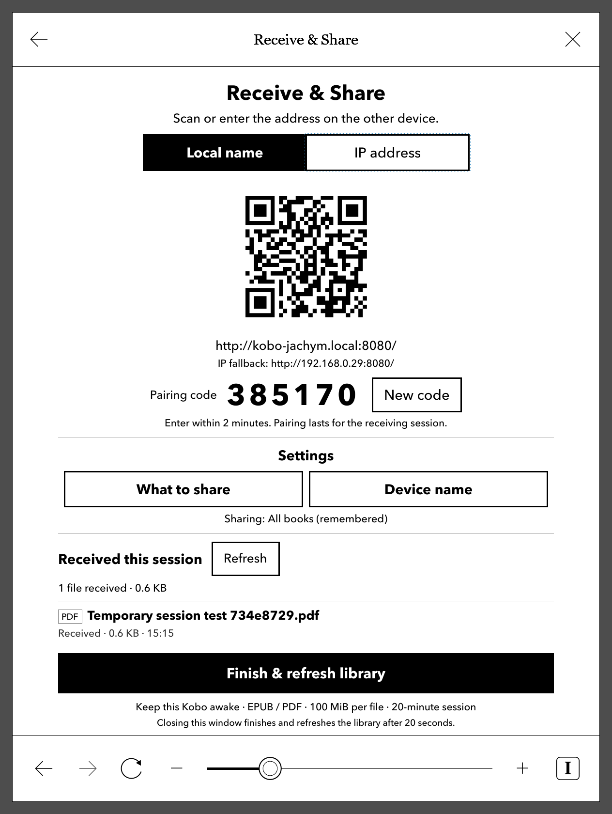
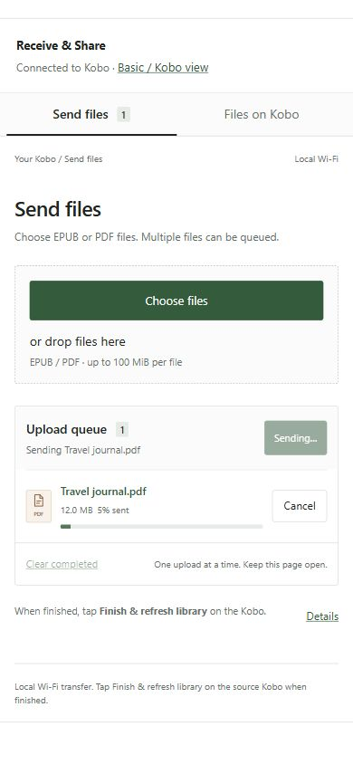
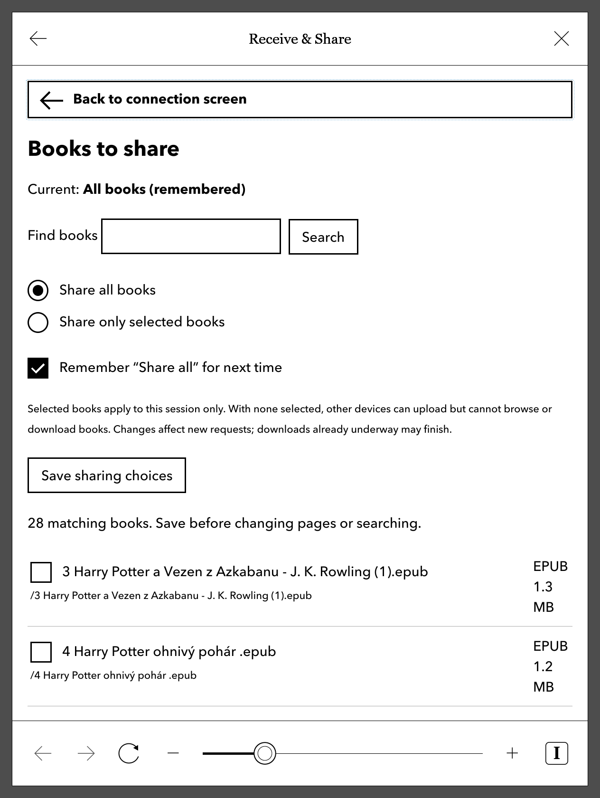
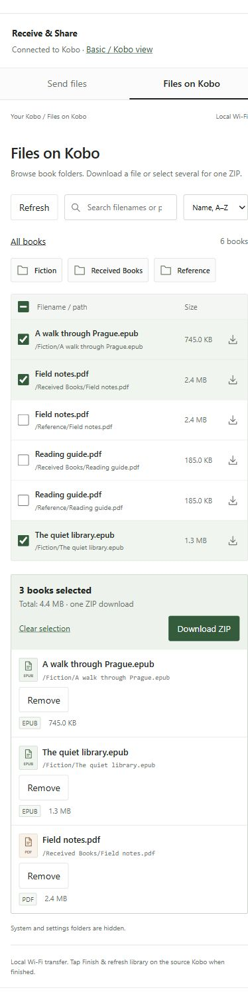
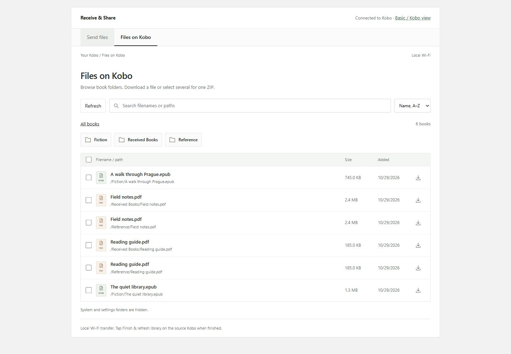

# Receive & Share for Kobo Libra 2

I made this so my wife could put books on her Kobo Libra 2 without a USB cable from either a phone or a computer.

Send EPUB and PDF files from a phone or computer over local Wi-Fi, using a browser.
You can also browse book folders and download individual books or a ZIP. A basic
browser view is provided for Kobo-to-Kobo sharing.

Tested on **Kobo Libra 2, firmware 4.38.23697**. Uses
[NickelMenu](https://github.com/pgaskin/NickelMenu) and
[NickelDBus](https://github.com/shermp/NickelDBus). Other models and firmware are
untested; [NickelMenu currently does not support firmware 5.x](https://pgaskin.net/NickelMenu/).
iOS and downloading and importing on a second Kobo still need testing.

The app avoids direct access to Kobo's database and firmware internals. It should
therefore keep working across firmware updates, provided NickelMenu and NickelDBus
remain compatible.

## Install

Choose according to what is already installed:

| Already installed | Package |
| --- | --- |
| NickelMenu and NickelDBus | `dist/KoboRoot.tgz` |
| NickelMenu only | `dist/with-nickeldbus/KoboRoot.tgz` |
| Neither | `dist/first-install/KoboRoot.tgz` |

Use dependency bundles only for missing dependencies; they do not detect versions
and will replace the bundled dependency binaries. App settings, received books and
other NickelMenu configuration files are preserved.

1. Finish any active transfer session and connect the Kobo by USB.
2. Copy the chosen **KoboRoot.tgz**, without extracting or renaming it, into `.kobo`.
3. Safely eject, unplug, and wait for installation and restart.

The archives pass local packaging tests but have not yet been installed through
an actual Kobo update cycle. [Manual ZIP installation and other details](docs/USAGE.md).

## Use

1. Connect both devices to the same Wi-Fi.
2. Open **NickelMenu → Receive & Share**. Startup may take a while. If it stalls,
   turn Wi-Fi on manually, connect to a network and launch it again.
3. Scan the QR code or enter the address, then enter the pairing code.
4. Choose files to upload, or open **Files on Kobo** to download books.
5. Tap **Finish & refresh library** on the source Kobo when done. It stops the
   server and asks Kobo to import received books. Closing the source browser also
   finishes the session after about 20 seconds when its heartbeat is working.

Uploads go into `Received Books`. Existing files are kept; duplicates get numbered
names. The limit is **100 MiB per file**, with a **20-minute session**. Pairing codes
expire after two minutes; paired browsers stay connected for the session.

**What to share** defaults to **Share only selected books**, with nothing selected.
Select books and save, or choose **Share all**. Remembering Share all enables it on
future launches; individual selections last only for the current session.

Keep the Kobo awake and avoid USB during transfers. If Wi-Fi drops, leave the
client page open and reconnect the Kobo. Interrupted uploads restart from the
beginning. Transfers use local HTTP without encryption.

## Screenshots

| Kobo | Phone browser |
| --- | --- |
|  |  |
| Books to share | Browse and download |
|  |  |

**Desktop file browser**



[More screenshots](docs/screenshots/README.md), including all Kobo, desktop and mobile views.
Phone screenshots use a narrow desktop browser viewport, not a physical phone.

## Build

Requires Go 1.26+ and Node.js. From PowerShell:

```powershell
.\build-installers.ps1
```

This builds and tests the app, fetches and verifies the pinned dependencies, and
creates all three installers in `dist/`.
[Build and packaging notes](installer/README.md).

## Uninstall

Finish the session, connect by USB, and remove `.adds/nm/kobo-receive` and
`.adds/kobo-receive`. Keep `Received Books`. NickelMenu and NickelDBus are separate
and remain installed.

## Contributing

Forks and pull requests are welcome. I would also appreciate testing on other Kobo
readers. Please include the model, firmware version, and what worked or failed.

## License

[MIT](LICENSE). Bundled third-party components retain their own licenses and notices.
