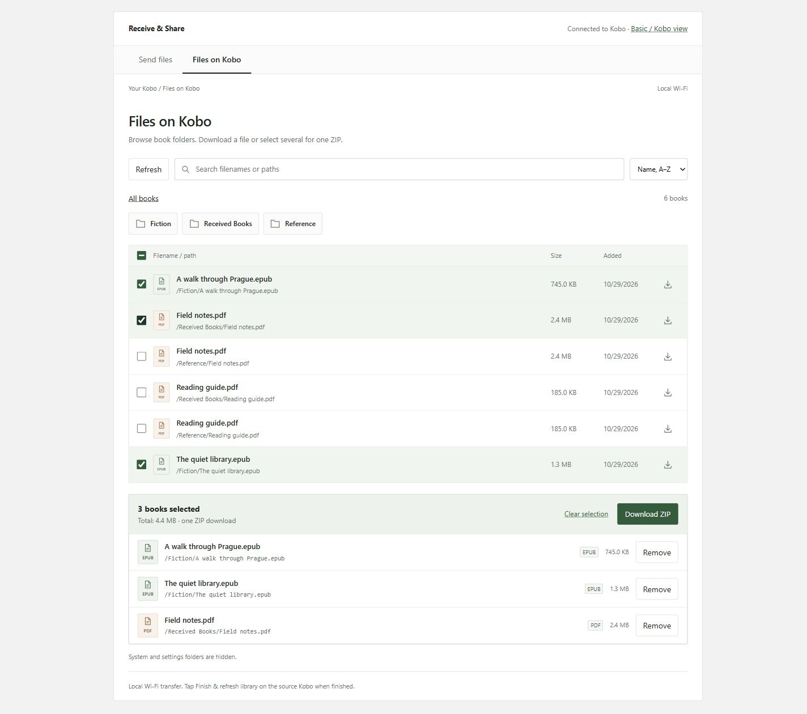
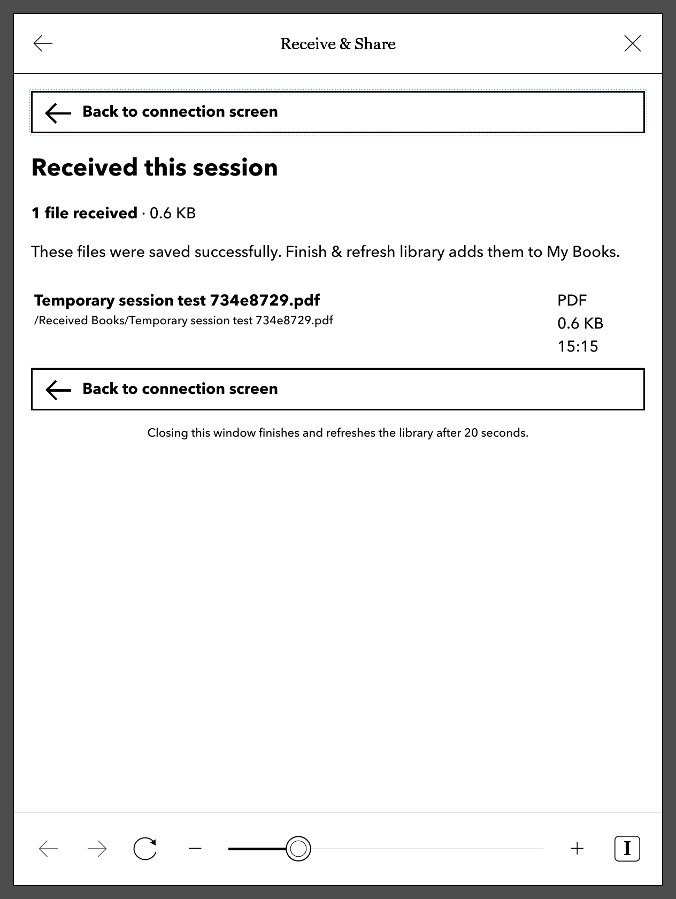

# Receive & Share

Transfer EPUB and PDF files over local Wi-Fi on a Kobo Libra 2 using NickelMenu.
The Kobo's built-in browser displays a QR code, short address, and pairing code.
Pair in your phone's browser to send multiple books, browse book folders, or download
books individually or as a ZIP. No account, cloud service, hotspot,
Python installation, or kernel change is needed.

## Screenshots

The source Kobo shows the connection details and received books; the paired client
queues files and shows progress for each upload.

| Source Kobo | Phone client |
| --- | --- |
| <a href="docs/screenshots/kobo-connection-received.png"></a> | <a href="docs/screenshots/mobile-upload-progress.jpg"></a> |

The file browser supports individual downloads and a selection across folders.
The selection summary sits above the full list of filenames, paths, types and sizes.

[](docs/screenshots/desktop-selected.jpg)

<details>
<summary>Sharing controls on the Kobo</summary>

Choose which books the other device can download, or remember **Share all** for
future sessions. The received-files screen records uploads from the current session.

| Books to share | Received this session |
| --- | --- |
| <a href="docs/screenshots/kobo-sharing.png"></a> | <a href="docs/screenshots/kobo-session-files.png"></a> |

</details>

See the [complete screenshot index](docs/screenshots/README.md) for all 27 images,
including pairing, upload queues, file details, the basic client, connection loss
and the finished-session screen. An [HTML gallery](docs/screenshots/index.html)
is also available for viewing locally.

Captured on 29 October 2026. Kobo images are actual Libra 2 framebuffer captures.
Client images use disposable sample books at desktop and phone-sized browser
viewports; the phone images are not physical Android/iOS captures. The finished
screen is a sample render of the production template with dummy receipts.

## Install

The production interface is embedded from `receiver/web/` into the executable.
The earlier [local prototype](prototype/index.html) and [UI plan](prototype/PLAN.md)
are retained for reference; `node prototype/server.mjs` serves that separate,
simulated prototype at http://127.0.0.1:4173.

1. Connect the Kobo by USB and tap Connect.
2. Extract `dist/kobo-receive-libra2.zip` on your computer with hidden files visible.
3. Copy its `.adds/kobo-receive` folder into the Kobo's `.adds` folder.
4. Copy its `.adds/nm/kobo-receive` **file** into the Kobo's `.adds/nm` folder.
   Merge the folders; retain existing NickelMenu configuration files.
5. Safely eject and disconnect USB. No firmware update or reboot is required.

Only the menu configuration file belongs in `.adds/nm`. The executable and
shell script belong in `.adds/kobo-receive`.

## Receive

1. Connect Kobo and phone to the same Wi-Fi. Guest networks with client isolation
   may prevent the connection. Finish connecting before opening the receiver.
2. On Kobo, choose **NickelMenu → Receive & Share**.
3. Scan the QR code with the phone's camera; open the link in your browser.
4. Enter the six-digit code shown on the source Kobo. Codes expire after two
   minutes; tap **New code** on the Kobo if needed. Already paired browsers stay connected.
5. Choose multiple EPUB/PDF files and tap **Send files**. Uploads run sequentially
   with progress, cancellation, and retry. Wait for each file's **Received** confirmation.
6. On Kobo, tap **Finish & refresh library** below the QR code. It stops new transfers, waits
   for active transfers, and asks Nickel to scan the books. Close the window to return.
   The duplicate finish menu entry has been removed; the button is on the Kobo page.

The QR-page button requires [NickelDBus](https://github.com/shermp/NickelDBus).
Install the official `KoboRoot.tgz` from its releases into `.kobo`, then eject;
the Kobo automatically installs the helper and restarts. NickelDBus 0.2.0 is the
version used for this device. The ZIP itself does not bundle or install it.

Books are saved in `Received Books` on the Kobo's USB-visible storage.
Existing books are never replaced: duplicates receive numbered names.
The receiver accepts up to 100 MiB per book and expires after 20 minutes.
During a Linux/Kobo session it temporarily enables the native ForceWifiOn setting
and reconnects Wi-Fi so idle power saving does not drop the connection. On normal
exit it restores the previous preference and reconnects again. A restoration marker
allows recovery on the next launch after an abnormal exit. `-keep-wifi=false` opts
out. The Kobo still needs to stay awake during transfers.
Keep the Kobo awake and don't connect USB during a transfer. If it sleeps or
loses Wi-Fi, reconnect it while keeping the phone page open.

## Local name, sharing, and reconnecting

The source screen offers **Local name / IP address** QR choices, keeping the choice
for that receiving session. A stable random
name such as `kobo-a1b2c3d4.local:8080` is saved in `settings.json` beside the
receiver. **Device name** changes it for the next session. mDNS probes for naming
conflicts, and a numeric IP fallback remains available. Wi-Fi address changes cause
advertising to restart without clearing the running session. Open the phone page
using the .local address for reconnection across IP changes; an already-loaded
numeric-IP page cannot follow a different address automatically.

Discovery follows the app's own network announcements through the pinned mDNS
library's public browsing API. It checks a per-run discovery identifier, interface,
IP and port, and refreshes the QR address and accepted hostname after conflict
renames. Fresh browse windows also detect a hostname-only rename. The separate
DNS-SD service-instance label is shortened to leave room for conflict suffixes;
the configured hostname keeps its full name. No dependency patch is required.

On the source Kobo, **What to share** selects **Share all** or specific books.
**Remember Share all for next time** persists that choice. Specific selections
last for the current session, including selections saved across sharing pages.
The default shares no books: paired devices can upload, but see no downloads until
the source permits them. Listing, individual downloads, review, and ZIP endpoints
all enforce this scope. Downloads already underway can finish after a scope change.

The enhanced phone page retains its queue, selected books, and folder during a
connection loss. It checks connectivity, retries entire interrupted files, and
uses per-client upload IDs to recover saved confirmations without duplicate books.
If the receiver restarts, pair again within the loaded page. Interrupted files from
the old session require an explicit retry after checking the library; queued files
and their in-memory file handles stay on the page. Reloading or closing the phone
page does not preserve those file handles. ZIPs and individual downloads use normal
browser downloads; interrupted downloads are not automatically restarted by the app.

The source Kobo page sends a local JavaScript heartbeat every three seconds.
After two successful heartbeats, closing that page triggers **Finish & refresh
library** after a 20-second grace period. Navigation between local settings pages
continues the heartbeat. The Linux monotonic clock excludes suspended time from
the grace period. Wi-Fi loss on a phone does not affect this loopback heartbeat.
Without working JavaScript, automatic finishing never arms; the manual button
remains available. `-auto-finish=false` disables this behavior. It is enabled by
default on Linux and disabled by default for the Windows development server.

## Browse and download

**Files on Kobo** lists EPUB/PDF files across user book folders, with search,
sorting, individual downloads, and selection across folders. The selection summary
is followed by every selected filename, full storage path, size, and file type.
Select **Download ZIP** and review the full list before starting the download.
ZIPs preserve folder paths, stream directly from the Kobo without recompression,
and are limited to 100 books / 512 MiB per archive. Keep both devices awake.

For an older browser, select **Basic / Kobo browser view** when pairing, or follow
that link afterward. It uses plain HTML without JavaScript, shows 100 books per
page, and offers ordinary download links and a ZIP review form. Selection in this
view applies to the current page. High-contrast CSS controls replace the Kobo
browser’s native checkbox/radio painting while retaining real HTML inputs.
Buttons and text fields also use flat, high-contrast styling and explicit
sans-serif fonts, with touch-sized controls and visible focus outlines. Kobo-to-Kobo transfer uses the receiving Kobo's
browser to pull individual books from the source; ZIPs are mainly for phones and
computers. Native Kobo download/import behavior still needs testing with a second Kobo.

Pairing uses a two-minute, six-digit code with ten attempts and a one-second attempt
interval. Successful pairing creates a random, HttpOnly browser-session cookie;
form submissions also require a CSRF token. All paired access ends when the receiver
stops. Hidden/system folders and symlinks are excluded, and file access is confined
to the configured storage root. There are no remote delete or rename operations.
Downloads also require the exact visible directory-entry path, rejecting FAT/Windows
short-name aliases that could otherwise reach hidden books. Request deadlines cover
Host rejection, and shutdown bounds the draining of non-transfer requests after
active transfers complete. Finish can wait for progressing transfers beyond the
normal page deadline. Re-pairing cancels old uploads and invalidates their callbacks
so an interrupted file requires an explicit retry in the new session.
Transfers use HTTP on your local network (not encryption). The QR/code screen and
Finish & refresh library route are accessible only through loopback on the source Kobo.

## Troubleshooting

- A startup error: make sure Wi-Fi is connected, then retry. Reconnect USB to read
  `.adds/kobo-receive/receiver.log` if needed.
- Phone cannot connect: same Wi-Fi, no guest/client isolation, and no VPN blocking
  local addresses. Try the printed URL directly. Keep Kobo awake.
- Missing books: run Finish & refresh library; check `Received Books` by USB.
- Session expired: Finish & refresh library, then Receive & Share and scan the new QR.

## Verified device

The QR screen, PDF upload from Fennec on Android, and QR-page Finish & refresh library
button were confirmed working on a Kobo Libra 2 with firmware **4.38.23697**
(Linux **4.1.15-00868-g58a2758be07**) on 28 October 2026. Live tests also observed
Nickel's `pfmDoneProcessing` completion signal. Other models and firmware need
their own device validation.

On 29 October 2026 the expanded receiver was installed and tested on this device:
PIN/cookie pairing, modern and basic uploads, book listing, byte-for-byte downloads,
and streamed ZIP contents passed. The .local hostname resolved from Windows.
A browser fault proxy verified whole-file retry after a dropped connection and
receipt recovery after a lost success response, with no extra saved copies.
The real Kobo browser ran the heartbeat, and closing it triggered the native
library scan and stopped the receiver. The local-name/IP QR switch was checked
on the real display. Wi-Fi retention was observed enabled during the session;
finishing produced the native completion signal, stopped receiving, restored
ForceWifiOn=false, and removed the restoration marker. The centered QR/pairing screen was checked using
a framebuffer screenshot. The enhanced interface was also exercised in a desktop
browser, including multi-file uploads and a downloaded ZIP. A second Kobo and iOS
browser have not yet been available for end-to-end testing.

## Uninstall

Run Finish & refresh library before connecting USB. Remove `.adds/nm/kobo-receive` and the
`.adds/kobo-receive` directory. Keep `Received Books` to retain uploaded books.
NickelDBus is separate: delete `.adds/nickeldbus` and reboot to uninstall that helper.

## Build

Go 1.26 or newer and the pinned modules in `receiver/go.mod` are required.
The package includes third-party dependency licenses.
On Windows, `./build.ps1` runs tests, builds the ARM executable, and creates the
install ZIP. It also requires Node.js for the local HTTP smoke test. Use
`./build.ps1 -Go C:\path\to\go.exe` to choose a compiler explicitly.

For a manual build, from `receiver`:

```sh
go test ./...
CGO_ENABLED=0 GOOS=linux GOARCH=arm GOARM=7 go build -trimpath -ldflags='-s -w' -o ../package/.adds/kobo-receive/kobo-receive .
```

For a real local test server, create separate storage and temporary directories,
then run `go run . -root PATH_TO_STORAGE -dest PATH_TO_STORAGE/Received -temp PATH_TO_TEMP -ip 127.0.0.1`.
Open http://127.0.0.1:8080/screen to see the pairing code, then open the root address
to pair. This server reads and writes actual files in those directories.

The executable is static ARMv7 Linux. The package uses NickelMenu's documented
modal browser, command chain, and `rescan_books` actions, plus NickelDBus for the
web button; it does not write to the Kobo database directly.
The menu starts asynchronously and waits for the Wi-Fi reconnect to settle before
opening the browser, avoiding a native connection prompt during startup.
The launcher enables IPv4 loopback (`127.0.0.1`) for the Kobo browser because
stock firmware may leave `lo` unconfigured. This is a runtime change; it does
not change saved Wi-Fi network credentials or firmware files.

`tools/` contains optional on-device deployment and import checks. SSH setup,
private keys, device backups, downloaded toolchains, and retired prototypes are
kept outside this repository. Generated binaries and build caches are ignored.

QR encoder: https://github.com/skip2/go-qrcode (MIT; license included in package).
NickelMenu documentation: https://github.com/pgaskin/NickelMenu/blob/master/res/doc

### HTTP port

The server accepts `-port` (default `8080`). On the Kobo, optionally create
`.adds/kobo-receive/port.txt` containing a number from 1 to 65535, then finish
and restart the app. The launcher, health check, browser and QR addresses use
that port. A running session keeps its port until it stops.
Port 80 removes the port suffix from addresses. Port 8080 permits use without
privileged-port permission on ordinary Linux hosts; it adds no encryption or
authentication. Leave `port.txt` absent to retain the default.

